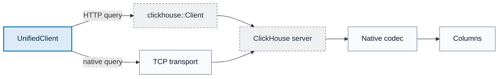

# Unified client: one entry point over two transports

Why this design exists, for anyone weighing it for upstream. The code is in `src/unified.rs`. This page is the argument, not the API reference.

`clickhouse::Client` speaks HTTP and nothing else. A native-TCP client is a
separate type with no shared interface, so a consumer that picks its transport
from config -- some deployments expose port 9000 and no HTTP at all -- has to
branch at every call site or wrap both itself.

## A dispatch enum

Both backends stay untouched. `UnifiedClient` is a thin dispatch enum over
them:

```rust
#[non_exhaustive]
pub enum UnifiedClient {
    Http(clickhouse::Client),
    Tcp(TcpClient),
}
```

Three client types coexist, and that is deliberate:

- `clickhouse::Client` for HTTP-specific work such as `JSONEachRow`, which the
  native protocol cannot accept.
- `TcpClient` for direct native access.
- `UnifiedClient` as the entry point that dispatches at runtime.

It dispatches the common subset: `execute`, `ping`, `fetch_columns` and `dynamic_insert`. `transport()` says which arm it is. HTTP-only methods stay reachable through `as_http() -> Option<&clickhouse::Client>`, so a caller that needs `insert_formatted_with` asks for the HTTP arm by name and gets a clear `None` on native rather than a confusing runtime error. `as_tcp()` does the same for the native arm.

The enum is the extension point. Another variant needs a dispatch arm in each method, and `#[non_exhaustive]` means no consumer's `match` breaks when one lands. Nothing in the codec knows which transport carried its bytes.

## Reads and inserts over both transports

Each arm sends the query its way, and the answer comes back as Native blocks that one codec decodes.



*Figure 1. L4 Detail -- Reads over both transports. clickhouse::Client and ClickHouse server are external.* Up: [L3 Components -- dfe-clickhouse](architecture.md).

`fetch_columns` returns column-wise `Columns` on either arm. The HTTP path sends `client_protocol_version`, so the server writes the revision of the Native format the TCP handshake negotiates, and decodes it with this crate's Native codec rather than upstream's reader, which rejects `JSON`, `Variant` and `Dynamic`. One codec serves both transports, which is why a `JSON` column reads the same over each. An HTTP read of an `Array` column a few thousand rows long can fail where TCP reads it, a defect tracked in [#48](https://github.com/hyperi-io/dfe-clickhouse-rs/issues/48).

`dynamic_insert` resolves the schema through whichever transport is configured and returns a `DynamicInsert` bound to it. The TCP arm resolves the schema eagerly, because `DynamicInsert::tcp` needs it up front. The HTTP arm leaves it to the first write. Encoding is RowBinaryWithNamesAndTypes for HTTP and Native columnar for TCP, sharing the encoder.

A caller that holds a `clickhouse::Client` or a `TcpClient` opens the insert directly. `DynamicInsert::http` takes a `DynamicSchemaCache` and reads the schema on the first write. `DynamicInsert::tcp` takes the schema, which `fetch_dynamic_schema_tcp` reads under an optional bound, and `with_schema_cache` names the cache a mismatch should drop it from. `fetch_dynamic_schema` is the same read over HTTP, for a caller that wants the schema itself.

`with_timeouts(InsertTimeouts::new(send, end))` bounds opening the INSERT, each send and the server's final answer, and over HTTP the schema read the insert makes. A step past its bound fails retriable, and `DynamicError::is_timed_out` says so. `with_schema_refresh(SchemaRefresh::AtExpiry)` keeps a cached schema through a mismatch until its TTL, for a caller that refreshes it itself. `schema()` hands back the shared schema the rows were encoded against. Keep that `Arc` before `end()`, which consumes the insert, and compare it with a fresh read (`DynamicSchema::same_columns`) once a rejection comes back.

`shape_for_type` applies the encoder's rules for a `JSON` value, a `Point`, a lone value bound for an `Array`, and zoned or over-precise date-time text to one value bound for a JSONEachRow body, for the column types `needs_shaping` names. It leaves numbers as they are, so a numeric epoch and an integer too wide for its column can store differently in the two formats, as [insert-formats](insert-formats.md#what-the-encoder-does-that-jsoneachrow-does-not) shows.
